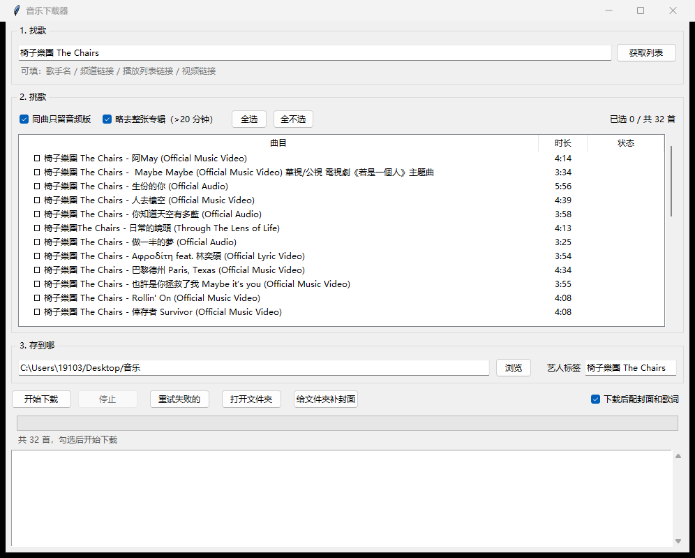

# 音乐下载器

Windows 上的一个桌面小工具：按歌手或链接找到歌，勾选，下成 MP3，顺手把专辑封面和歌词一起配好。



## 能干什么

**找歌**　输入歌手名、频道链接、播放列表链接或单个视频链接，抓出曲目列表。歌手名走 YouTube 搜索结果，取前 40 条。

**挑歌**　点行勾选。两个开关随时重算列表：

- 同曲只留音频版：同一首歌同时有 MV 和 Official Audio 时，只留 Audio
- 略去整张专辑：把 20 分钟以上的 Full Album、全场 Live 筛掉

**下载**　MP3，最高质量（VBR 0）。文件名取歌名，去掉「频道名 - 」前缀和 (Official Audio) 这类尾巴，Windows 不认的字符（`? : * /` 等）换成下划线，重名自动加 (2)(3)。

**配封面和歌词**　每首下完再走两步：

- 封面去 iTunes 搜专辑图，600×600，直接嵌进文件
- 歌词去网易云搜带时间轴的 LRC，一份嵌进 USLT 标签，一份存成同名 `.lrc`

**补封面**　已经下好的歌，点「给文件夹补封面」批量配上，只动封面不碰其他标签。

**扛风控**　一次下太多，YouTube 会要求登录验证。程序自己等 15 分钟重试，连续 6 次不行才停下，过一阵点「重试失败的」接着补。

## 环境

Windows，Python 3（tkinter 是标准库自带的），再加三个命令行工具：

```bash
pip install mutagen
winget install yt-dlp ffmpeg        # 或者 scoop install yt-dlp ffmpeg
```

`yt-dlp` 要偶尔更新一下，不然 YouTube 改版后抓不到：`yt-dlp -U`

## 怎么用

双击 `音乐下载器.bat`（或者直接跑 `pythonw 音乐下载器.pyw`）。

1. 填来源，点「获取列表」
2. 列表里勾选要的曲目，填艺人名（配封面靠它认人）
3. 选保存目录，点「开始下载」

进度和报错都在窗口下方的日志区。上次用的目录和艺人名存在同目录的 `配置.json`。

## 实现上的几处细节

- 下载先落到目标目录下的 `_临时`，ffmpeg 洗完标签再改名搬正，中途断了不会在正式目录留半成品
- 封面匹配按「歌名相似度为主、时长差为辅」打分，配不上就跳过，不硬塞一张错图。为此做了三件事：繁简对照（iTunes 用「樹屋」、网易云的「树屋」也能对上）、中英混排歌名拆分（`城市潛水 City Diving` 只拿中文段去搜）、时长容差放到 40 秒（YouTube 版常比唱片多出前奏尾奏），现场版和伴奏版本自动排除
- 歌词写进 USLT 帧而不是 TXXX，不少播放器只认前者。另外存一份 `.lrc`，手机播放器读这个最稳
- 同时存了专辑名（TALB），播放器里能按专辑归堆

## 已知限制

- 封面靠 iTunes 台湾区，没收的配不上。实测 62 首里 5 首没配上（没收录、或 Apple 上换了歌名的）
- 歌词靠网易云，纯器乐和冷门曲目会空着
- 只在 Windows 上跑过，Linux/macOS 上 `.bat` 用不了，`.pyw` 应该能跑但没试
- 繁简对照表是手写的一百来字，不是完整转换

## 免责声明

这个工具只是给 `yt-dlp` 套了个界面，用它下载任何东西仍然受对方平台条款和当地法律约束。请只下载你有权获取的内容，不要拿去做二次分发或商业用途。
